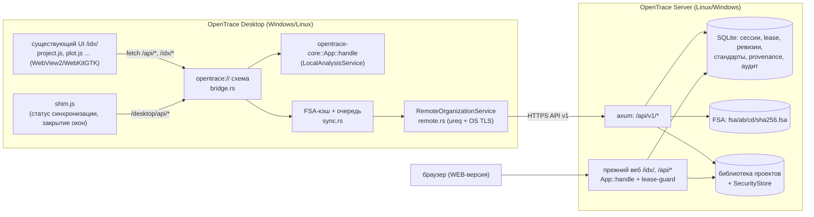

# OpenTrace Desktop + OpenTrace Server: архитектура

Статус: рабочий вертикальный срез (этапы A, B, C, D; численная переносимость решена). Что проверено, а что нет, — в `ROADMAP.md`.

## 1. Продукты и общее ядро

```text
open_trace/
├── core/opentrace-core/          расчётное ядро + прежний HTTP-сервер/CLI `opentrace` (без изменений поведения)
├── desktop/opentrace-desktop/    OpenTrace Desktop (Tauri 2): src-tauri/ (Rust), ui/ (shim, страницы десктопа)
├── server/opentrace-server/      OpenTrace Server: API v1 + прежний веб-интерфейс, SQLite, хранилище FSA
├── resources/web, resources/data общий интерфейс ID-X и поставочные данные (используются всеми тремя)
└── docs/desktop/                 эта документация
```

* `opentrace-core` не зависит ни от Tauri, ни от axum, ни от конкретной СУБД сервера. Десктоп и сервер вызывают **одни и те же** функции; алгоритмы не копируются.
* Каждый новый крейт — отдельный Cargo workspace со своим `Cargo.lock`, ссылающийся на ядро по пути. Docker-образ `opentrace` и его `core/Cargo.lock` не получают GUI-зависимостей.
* Прежний бинарник `opentrace` и Docker Compose продолжают работать как раньше.



## 2. Desktop

### 2.1 Подключение существующего UI без HTTP-сервера (ADR-1)

Tauri регистрирует асинхронный протокол `opentrace`. Каждый запрос страницы (`/idx/project.html`, `fetch('/api/analyze?…')`, `/api/idx-project`, …) попадает в `bridge::handle`, переводится в `opentrace_core::server::Request` и обрабатывается **тем же** `App::handle`, что и в HTTP-сервере, — на пуле рабочих потоков (ядра − 1, минимум 2), не в UI-потоке.

* Нет локального TCP-порта: другие программы на ПК не могут обратиться к API десктопа.
* UI не переписывается: относительные `fetch`, `X-Session-Token`, `window.open` работают как в браузере.
* Host/Origin страницы (`http://opentrace.localhost` на Windows, `opentrace://localhost` на Linux) заменяются loopback-хостом сеанса ядра; проверка токена сеанса остаётся.
* HTML отдаётся с CSP (`default-src 'self'`, без внешних скриптов, `object-src 'none'`), `Cache-Control: no-store`, `nosniff`.
* Навигация за пределы своей схемы запрещена (`on_navigation`), `window.open` на чужие адреса отклоняется.
* Tauri IPC (команды JS→Rust) **не используется**: capability-файлов нет, команд нет. Десктопные функции доступны только как `/desktop/api/*` той же схемы.

Альтернативы, отклонённые: (а) запуск `opentrace serve` на localhost — открытый порт, лишний HTTP-слой, проблемы с правами/брандмауэром; (б) переписать `fetch` на Tauri `invoke` — правка всего UI, JSON-сериализация больших бинарных тел.

### 2.2 Окна и `window.opener` (ADR-2)

UI открывает Samples/Genotypes Plot, Panel Manager, Report Manager, печать через `window.open` и синхронно вызывает `window.opener.OT.*`. Десктоп обрабатывает `window.open` через `on_new_window` и создаёт настоящее нативное окно с `window_features(features)`: WebView2 получает новое окно в том же окружении, WebKitGTK — связанный view. Движок сам связывает `window.opener` — синхронные вызовы работают без переписывания `plot.js`. Это проверяется самотестом (`opener_ot`, отрисовка canvas).

Окно графиков рисует панели по мере прокрутки (`IntersectionObserver` в `plot.js`): при 96 образцах в раздельных панелях это 384 canvas, а перерисовка всех на каждое изменение выделения занимала секунды. Пиксели те же; печать рисует свои canvas синхронно.

Геометрия главного окна сохраняется плагином window-state; геометрия всплывающих окон — собственным кодом (`geometry.rs`) по виду окна (`plot-7` → ключ `plot`, файл `popup-geometry.json` рядом с `desktop.json`): окно графиков, перенесённое на второй монитор, открывается там же. Положение задаётся построителю окна до его создания. Плагин для всплывающих окон не используется: он двигал окно из хука, который Tauri вызывает под блокировкой хранилища плагинов, а всплывающее окно создаётся внутри обработчика WebView2 NewWindowRequested (вне обработчика цикла событий), поэтому `WM_MOVE` приходил синхронно и поток UI ждал сам себя (зависание при повторном открытии окна того же вида на Windows, подтверждено дампом). `window.close()` из страницы или из окна-владельца закрывает окно через приложение (`/desktop/api/window/close-confirmed`): WebView2 в ответ на закрытие скриптом уничтожал только webview, и на экране оставалось пустое белое окно.

Закрытие окна: перед нативным закрытием shim вызывает обработчики `beforeunload` страницы (они уже знают о несохранённых изменениях проекта/панелей/отчётов) и спрашивает подтверждение. Если страница не отвечает 3 с, повторное закрытие пропускается (окно всегда можно закрыть). Случайный F5/Ctrl+R блокируется, если страница сама не обработала клавишу.

### 2.3 Анализ и FSA

* Импорт: существующий диалог «Добавить образцы» (файлы, папка через `webkitdirectory`, Drag & Drop — нативный обработчик Tauri отключён, чтобы работал HTML5 drop).
* Анализ: `POST /api/analyze` с бинарным телом → ядро локально. Параллелизм задаёт UI (до 4), выполнение — пул Rust.
* Синхронизация: после успешного анализа shim передаёт **тот же Blob** в `/desktop/api/fsa/sync` (бинарно). Rust считает SHA-256, кладёт файл в контентный кэш (`fsa-cache/ab/cd/<sha>.fsa`, запись через временный файл и проверку хеша), очередь из 2 потоков делает `HEAD /api/v1/fsa/{sha}` и при отсутствии — потоковый `PUT`. Ошибки сети — экспоненциальная пауза до 5 мин; истёкший вход — пауза очереди до следующего входа; 422 (хеш не совпал) — копия в кэше удаляется. Очередь переживает перезапуск (кэш и есть очередь). Оригиналы пользователя не изменяются.
* Два статуса: прогресс анализа (прежняя полоса) и отдельная ячейка «Синхр. FSA» в строке состояния.

### 2.4 Сервер организации из десктопа

`RemoteOrganizationService` (`remote.rs`) работает в Rust: токен сеанса не попадает в JavaScript, хранится в хранилище учётных данных ОС (Windows Credential Manager, Linux keyring), пароль не сохраняется. TLS — системное хранилище сертификатов (корпоративный CA, установленный на ПК, работает) плюс необязательный PEM внутреннего CA. `http://` разрешается только явной отметкой с предупреждением; автоматического перехода на HTTP при ошибке TLS нет. Перенаправления отключены.

Страница `/desktop/connection.html`: адрес, проверка (health + capabilities + сравнение версии алгоритма и математики клиента и сервера), вход/выход, состояние очереди, список проектов сервера (просмотр, кто редактирует), утверждённые лабораторные профили.

### 2.5 ProjectWorkspace: проекты сервера (ADR-6)

Переключатель «Где хранятся проекты» (страница «Сервер организации»): на этом компьютере или на сервере. В режиме сервера `bridge.rs` направляет запросы UI `POST /api/idx-project` в `workspace.rs`, остальной UI не меняется:

* `list` — проекты сервера (с ревизией и тем, кто редактирует);
* `open` — захват lease; если проект занят или нет права `expert` — открытие **только для чтения** (баннер в главном окне, ячейка «Сервер: только чтение» в строке состояния);
* `save_meta` / `save_sample` — с `X-Lease-Id`, `X-Fencing-Token`, `X-Expected-Revision`; исходный FSA уходит один раз бинарно (`HEAD`/`PUT /api/v1/fsa/{sha}`), привязывается к проекту, образец сохраняется с `fsa_sha256` — base64 на сервер не передаётся;
* конфликт ревизии или потеря lease → отказ с объяснением, проект для этого клиента становится только для чтения; last-write-wins нет;
* heartbeat каждые 25 с; освобождение при открытии другого проекта, выходе из учётной записи, переключении на локальные проекты и закрытии приложения;
* удаление, переименование, копирование и импорт проектов сервера — в веб-менеджере проектов сервера.

### 2.6 Лабораторные стандарты в десктопе

`/desktop/standards.html`: список версий (статус, автор, утвердивший, SHA-256), действия жизненного цикла (права проверяет сервер), импорт справочников этого приложения из `localStorage` как черновиков (сравнение по каноническому SHA-256: совпадает → пропуск, отличается → новая версия; утверждённое не меняется, локальные данные не удаляются), конструктор лабораторного профиля из утверждённых версий. Запросы идут через ограниченный прокси `/desktop/api/v1/{standards,lab-profiles,me}` в Rust — токен остаётся вне JavaScript.

**Активный лабораторный профиль и происхождение анализов (provenance).** «Использовать на этом компьютере» для утверждённого профиля загружает его метод анализа и стандарт длин в локальную библиотеку (замена отличающегося одноимённого локального элемента — только после подтверждения) и активирует профиль. Rust (`labprofile.rs`) при активации и после входа заново вычисляет SHA-256 профиля и обоих стандартов (должны совпасть с закреплёнными) и получает настройки анализа, которые из них строит ядро (`analyze_settings` — та же функция, что вызывает UI).

Каждый успешный `/api/analyze` отмечается в `provenance.rs`: SHA-256 FSA, настройки в точности как их отправил UI (без имени файла), версия алгоритма, SHA-256 ответа ядра. Когда UI сохраняет образец в серверный проект, запись уходит в `POST /api/v1/projects/{name}/analyses` под блокировкой проекта — один раз на результат. Ссылка на профиль добавляется, **только если** отправленные настройки совпадают с настройками профиля (те же ключи и значения; ручная коррекция размеров, матрица и любые изменения — уже не профиль) **и** образец генотипирован набором, собранным из утверждённых набора, бинов, статтеров и метода профиля. Для этого Rust разбирает тексты GeneMapper, которые UI отправляет в `/api/import-gm-kit`, парсерами ядра и сравнивает со структурами профиля, запоминает хеш собранного набора и при `/api/str-run` связывает набор с образцом по `source_sha256`. Набор, собранный до выбора профиля, профильным не считается. «Использовать на этом компьютере» загружает и набор (панели, бины профиля, ровно его статтеры; другие наборы бинов набора сохраняются). Неоднозначность не угадывается: если один FSA анализировался в сеансе с разными настройками, запись не отправляется (`ambiguous`). Счётчики (`posted`, `ambiguous`, `profile_mismatch` с причиной) — в `/desktop/api/workspace/status` и в подсказке ячейки проекта; щелчок по ячейке открывает `/desktop/provenance.html` — записи проекта с сервера (через ограниченный прокси, только `GET projects/{name}/analyses`). Сервер дополнительно проверяет, что версия профиля утверждена.

### 2.7 Математика

`exp`/`log`/`pow` ядра — побитовый порт glibc (`libm_port.rs`), поэтому десктоп на Windows и сервер на Linux дают одинаковые результаты (см. `BASELINE_AUDIT.md` §4).

## 3. Server

### 3.1 Состав

Один нативный бинарник `opentrace-server` (Linux и Windows, без Docker и GUI), axum + tokio, SQLite (rusqlite, bundled):

* `/api/v1/*` — API организации (см. §3.3);
* всё остальное — прежний веб-интерфейс и `/api/*` через `App::handle` (флаг `legacy_web`), с guard'ом блокировок;
* CLI: `serve`, `check-config`, `migrate`, `set-password`, `grant-approver`, `backup`, `verify-backup`, `restore`, `version`.

Каталог данных (`data_dir`): `opentrace.sqlite3` (WAL, `synchronous=FULL`), `fsa/` (контентное хранилище), `projects/` (библиотека проектов — та же, что у WEB), `security/` (пользователи и аудит — тот же `SecurityStore`), `tmp/`. Один процесс на каталог (`server.lock`, `File::try_lock`); административные CLI-команды требуют остановленного сервера.

### 3.2 Единая база пользователей и ролей (ADR-3)

Вход в API v1 проверяется `SecurityStore::login` — те же пользователи, пароли (PBKDF2), политика блокировки и журнал входов, что у веб-интерфейса. Роли API v1 **вычисляются** из прав `SecurityStore`, отдельной таблицы ролей нет:

| Роль | Условие |
|---|---|
| `admin` | право `AdminToolAcc/Users/Modify` |
| `approver` | член группы пользователей «OpenTrace Approvers» (`grant-approver`) |
| `method_author` | любое из `UPDATE_ANALYSIS_METHOD`, `UPDATE_PANEL`, `UPDATE_SIZE_STANDARD`, `UPDATE_MATRIX` |
| `expert` | `UPDATE_PROJECT` |
| `viewer` | `READ_PROJECT` |

Сеансы API: случайный 256-битный токен, в БД хранится только SHA-256, срок жизни `session_ttl_hours`, выход отзывает токен и освобождает lease сеанса. Вход ограничен 10 попытками в минуту с одного адреса поверх политики учётных записей. Объектные права проектов (группы безопасности, владелец) проверяются тем же кодом, что и в WEB.

### 3.3 API v1

| Метод и путь | Права | Назначение |
|---|---|---|
| `GET /api/v1/health` | — | статус, версии сервера, алгоритма, математики |
| `GET /api/v1/capabilities` | — | версии API, возможности, лимиты, транспорт |
| `POST /api/v1/auth/login` / `logout`, `GET /api/v1/me` | — / сеанс | вход, выход, роли |
| `GET /api/v1/projects`, `GET /api/v1/projects/{name}` | viewer | список с ревизией и держателем lease; проект только для чтения |
| `POST /api/v1/projects/{name}/lease` | expert | захват (или подтверждение своим сеансом) |
| `POST …/lease/renew`, `DELETE …/lease` | владелец | heartbeat, освобождение |
| `POST …/lease/force-release` | admin | принудительный сброс с причиной (аудит) |
| `POST /api/v1/projects/{name}/idx` | viewer / expert+lease | `open`, `open_sample`, `export` / `save_meta`, `save_sample` (`fsa_sha256` вместо base64) |
| `GET|POST /api/v1/projects/{name}/fsa` | viewer / expert+lease | привязка исходных FSA к проекту |
| `GET|POST /api/v1/projects/{name}/analyses` | viewer / expert+lease | provenance анализа |
| `HEAD|GET|PUT /api/v1/fsa/{sha256}` | viewer / expert | контентное хранилище FSA |
| `GET /api/v1/standards`, `GET /api/v1/lab-profiles` | viewer | версии стандартов, утверждённые профили |
| `POST /api/v1/standards/{kind}/{name}`, `PUT …/{version}` | method_author | черновик, правка черновика автором |
| `POST …/{version}/submit|approve|reject|deprecate|archive` | автор / approver / admin | жизненный цикл |
| `GET /api/v1/audit` | admin | журнал API |

Мутации проекта требуют заголовков `X-Lease-Id`, `X-Fencing-Token`, `X-Expected-Revision` (или `If-Match`). Ошибки — JSON `{"error", "code", …}`: `401 unauthorized`, `403 forbidden`, `409 project_locked` (+`locked_by`, `read_only_available`), `409 lease_lost`, `409 revision_conflict` (+`expected_revision`, `current_revision`), `409 fsa_missing`, `413 too_large`, `422 hash_mismatch|not_abif`, `428 lease_required|revision_required`, `429 rate_limited`.

### 3.4 Один редактор проекта: lease + fencing + ревизия (ADR-4)

* `project_leases.name` — первичный ключ: не больше одной lease на проект. Все операции — `BEGIN IMMEDIATE`, поэтому гонка двух потоков или двух процессов имеет ровно одного победителя (тест на 8 параллельных соединениях).
* `project_state.fencing_seq` растёт при каждом захвате и никогда не уменьшается (в том числе после истечения, принудительного сброса и перезапуска).
* Просроченную lease нельзя продлить — только захватить заново (новый токен) и перечитать ревизию.
* Каждая мутация в той же транзакции проверяет lease_id, сеанс, срок, fencing-токен и ожидаемую ревизию, затем пишет и увеличивает ревизию. Ошибка записи откатывает всё.
* Состояние в SQLite, а не в памяти: перезапуск сервера не снимает блокировок и не сбрасывает токены (тест).
* **WEB не обходит блокировку**: прежний `POST /api/idx-project` для `save_meta`, `save_sample`, `delete`, `rename`, `save_as`, `import` проверяет lease под тем же замком БД, что и выдача lease; при чужой lease — `409 project_locked`; импорт без явного имени отклоняется, пока есть хоть одна активная lease. Принятая WEB-запись увеличивает ревизию, поэтому клиент с устаревшей ревизией получит конфликт, а не перезапишет её. Чтение из WEB работает всегда.
* **Два браузера тоже не затирают друг друга** (без изменений веб-интерфейса): сервер помнит для каждого сеанса браузера (`X-User-Ticket`, хранится только SHA-256) и проекта ревизию, которую этот сеанс последним открыл или записал (таблица `web_views`, миграция 3). Запись отклоняется `409 revision_conflict`, если проект с тех пор изменился (другим браузером, десктопом или API) — пользователь сохраняет под другим именем или открывает заново. Без открытия можно писать только в новый проект или в проект, который через этот сервер ещё не менялся. Ограничение: две вкладки одного входа (один ticket) считаются одним клиентом.
* Офлайн-редактирование серверного проекта не допускается (нет lease без связи); last-write-wins отсутствует.

### 3.5 Лабораторные стандарты и профили (ADR-5)

Виды: `analysis_method`, `kit`, `bin_set`, `stutter`, `size_standard`, `matrix`, `lab_profile`. Каждая версия хранит канонический JSON (ключи отсортированы) и его SHA-256. Жизненный цикл `draft → pending_review → approved → deprecated → archived` (отклонённое — `archived` с причиной). Правило четырёх глаз: автор/отправитель не утверждает. Неизменяемость после отправки обеспечивается и кодом, и триггерами SQLite (UPDATE содержимого и DELETE не-черновиков запрещены). Новая версия создаётся рядом и ничего не пересчитывает.

`lab_profile` — набор ссылок `{kind, name, version}` (не больше одного каждого вида; метод, кит, бины и стандарт длин обязательны). При отправке на утверждение в профиль записываются SHA-256 членов, утвердить можно только при утверждённых членах.

Provenance анализа (`/analyses`): SHA-256 исходного FSA (должен быть в хранилище), версия алгоритма, канонические параметры и их SHA-256, профиль (имя, версия, SHA-256 содержимого, только утверждённый), SHA-256 результата, ревизия проекта, пользователь, время.

### 3.6 Хранилище FSA

`PUT /api/v1/fsa/{sha256}`: поток пишется во временный файл в `data/tmp` с подсчётом хеша и лимитом размера, проверяется сигнатура `ABIF`, `fsync`, затем атомарный `rename` в `fsa/ab/cd/<sha>.fsa`. Несовпадение хеша — 422 без следов. Повтор того же содержимого — 200 без второй копии. Скачивание — потоково блоками по 64 КиБ. Файлы не изменяются; удаление FSA через API не предусмотрено.

### 3.7 Сеть и TLS

* `transport = "proxy"` (по умолчанию): сервер слушает только loopback, TLS завершает обратный прокси (Caddy/nginx/IIS ARR) с сертификатом внутреннего CA.
* `transport = "http"` на сетевом адресе — сервер **не стартует** без `allow_insecure_http = true` и пишет предупреждение в журнал.
* Журнал запросов: метод, путь, код, время; без query-строк, заголовков, тел и токенов.

### 3.8 Миграции, резервные копии

Нумерованные миграции в `db.rs` (только добавление), версия в `schema_migrations`; сервер отказывается работать с более новой схемой. `backup` делает онлайн-снимок SQLite (backup API, безопасно при работающем сервере), копирует проекты, security и FSA, пишет `manifest.json` с SHA-256 всех файлов; `verify-backup` проверяет; `restore` — только в пустой каталог, после проверки манифеста, с последующей миграцией.

### 3.9 PostgreSQL

Не реализован. SQL сосредоточен в `db.rs`, `leases.rs`, `standards.rs`, `api.rs`; для PostgreSQL потребуется слой репозитория (trait) и `SELECT … FOR UPDATE` вместо `BEGIN IMMEDIATE`. Не делаем в первой версии, как и требовалось.

## 4. Безопасность (сводка)

* Сервер проверяет права на каждом запросе; JS-проверки UI — только удобство.
* Секреты: токены — хранилище ОС (десктоп), SHA-256 токенов (сервер); пароли не сохраняются клиентом.
* Directory traversal: имена проектов валидируются (`< > : " / \ | ? *` запрещены), SHA-256 — ровно 64 hex, пути манифеста резервной копии проверяются.
* Лимиты: FSA 64 МиБ (настраивается), API v1 JSON — 2 МиБ (кроме `/idx` с прежним лимитом), вход 10/мин.
* Журналы без чувствительных данных; телеметрии нет.
* Локальный кэш FSA десктопа: каталог данных пользователя, лимит 4 ГиБ, вытесняются только уже отправленные файлы; очистка — удаление каталога `fsa-cache` (оригиналы не затрагиваются).
* ПО исследовательское, не валидировано для диагностики и судебной экспертизы; это показывается в интерфейсе подключения и в `/api/v1/health` (`research_only: true`).
